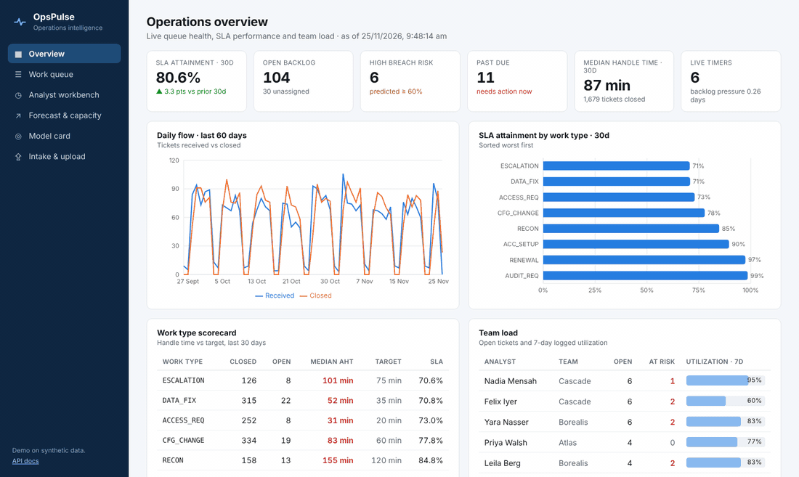
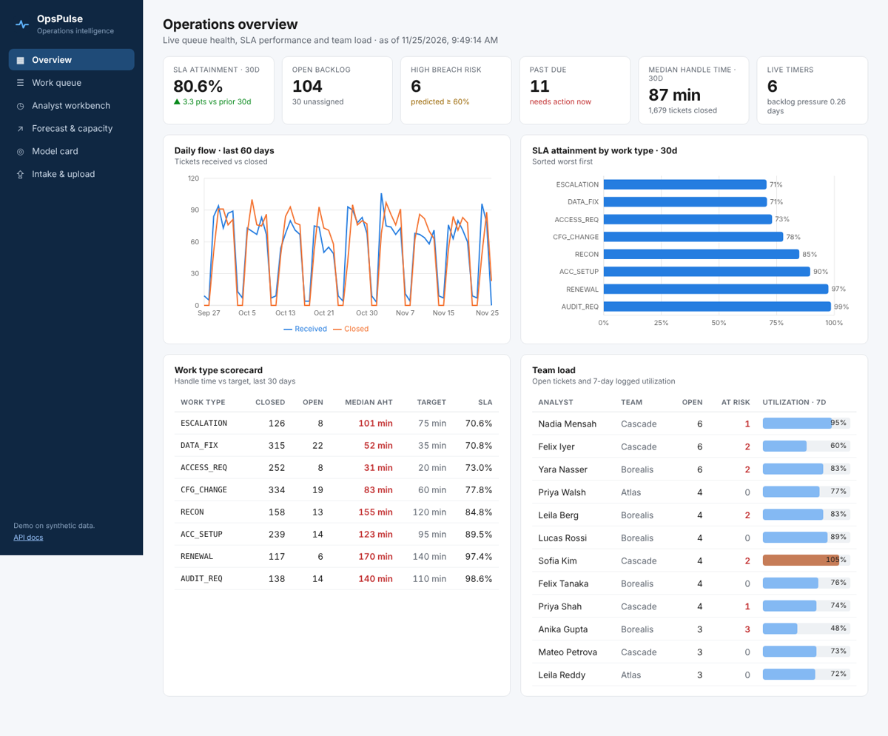
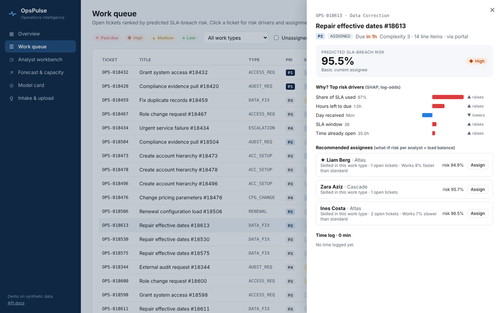
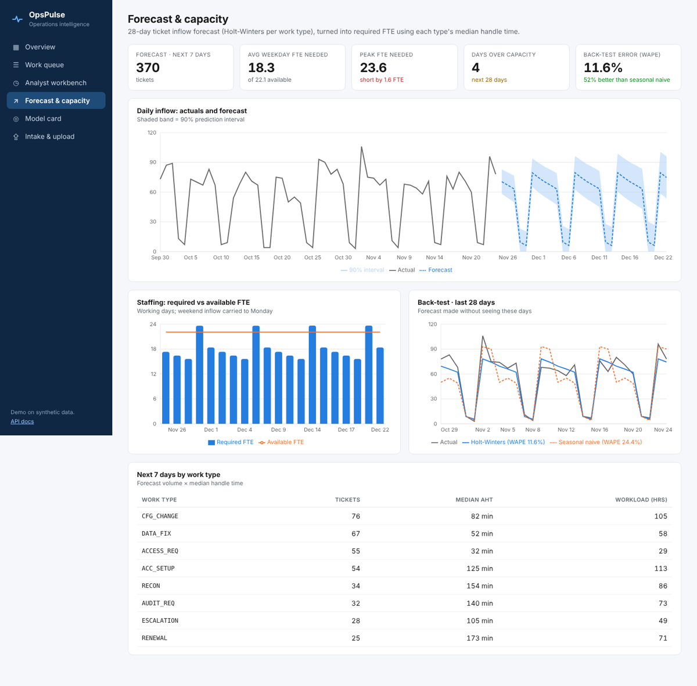
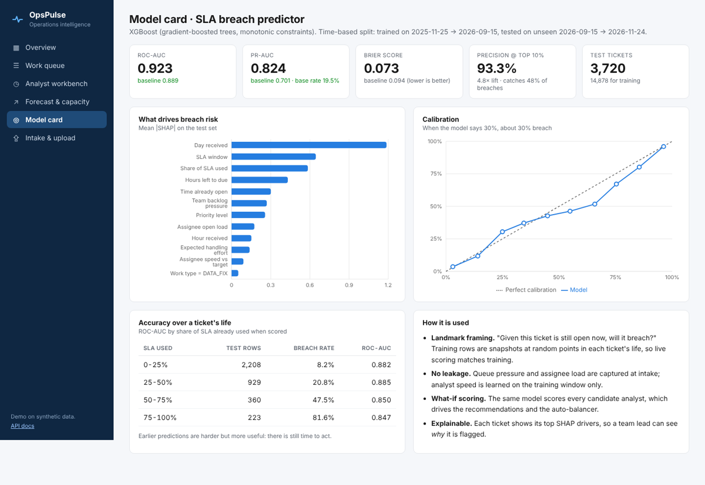
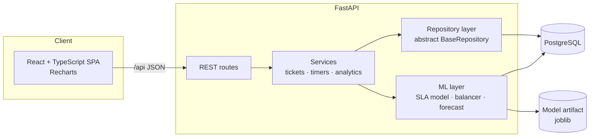

<div align="center">

# OpsPulse

**Work Management · SLA Risk · Forecasting**

Operations work intelligence: predict SLA breaches before they happen, route work to the right analyst, and plan staffing from a forecast.

FastAPI · React + TypeScript · PostgreSQL · XGBoost + SHAP · Holt-Winters · Hungarian assignment · Docker · GitHub Actions

[Live demo](#-live-demo) · [Architecture](docs/ARCHITECTURE.md) · [Model card](docs/MODEL_CARD.md) · [Deploy](docs/DEPLOY.md)



</div>

---

## Why this exists

Back-office operations teams (configuration, onboarding, reconciliations, access requests) usually run on Excel exports and gut feel. A team lead finds out a ticket breached its SLA **after** it breached. Work is handed out by whoever shouts loudest, and staffing is planned from last month's headcount rather than next month's volume.

I built the first version of this inside a real operations team: an internal tool that took a 35-analyst team off spreadsheets and onto live, tracked work. **OpsPulse is a clean-room rebuild for my portfolio**: new code, a production-style architecture, and an ML layer on top. It runs entirely on synthetic data, so no employer code or data is included.

## What it does

| | Capability | How |
|---|---|---|
| 🎯 | **SLA-breach prediction** for every open ticket, refreshed on every view | XGBoost with monotonic constraints, framed as a *landmark* model ("given it's still open now, will it breach?") |
| 🔍 | **Explanations a team lead can act on** | Per-ticket TreeSHAP drivers ("72% of SLA used", "assignee holds 6 open tickets") |
| ⚖️ | **Workload balancing** | What-if risk for every analyst, then a min-cost assignment (Hungarian algorithm) under per-analyst capacity caps |
| 📈 | **Inflow forecast → staffing plan** | Holt-Winters per work type, then volume × median handle time → required FTE vs available FTE |
| ⏱️ | **Live work timers for many concurrent analysts** | Server-authoritative timestamps and one-running-timer-per-analyst enforced by a Postgres partial unique index |
| 📥 | **Bulk intake** | CSV/Excel upload with row-level validation report |

## Results (on held-out, later-in-time data)

| SLA-breach model | XGBoost | Logistic baseline |
|---|---|---|
| ROC-AUC | **0.92** | 0.89 |
| PR-AUC (base rate ≈ 20%) | **0.82** | 0.70 |
| Brier score (lower is better) | **0.073** | 0.094 |
| Precision on the riskiest 10% | **93%** (4.8× lift) | |

| Inflow forecast (28-day back-test) | WAPE |
|---|---|
| Holt-Winters per work type | **11.6%** |
| Seasonal naive (same weekday last week) | 24.4% |

Exact figures move slightly with the seed date. See the [model card](docs/MODEL_CARD.md) for the split, calibration, accuracy by ticket age and limitations.

## Screenshots

| Overview | Work queue + risk drivers |
|---|---|
|  |  |
| **Forecast & capacity** | **Model card** |
|  |  |

## Architecture



Key decisions (details in [ARCHITECTURE.md](docs/ARCHITECTURE.md)):

- **Timers live on the server.** The client only renders `now − started_at`, so timers survive refreshes, tabs and devices. This fixes the failure mode of the original Streamlit prototype, which could not hold dozens of live timers.
- **One code path for features.** Training and live scoring call the same `build_features()`, so there is no train/serve skew.
- **Leakage-safe by construction.** Queue pressure and assignee load are snapshotted at intake, the split is time-based, and analyst speed is learned on the training window only.
- **Repository pattern with an abstract base**, so services depend on an interface rather than concrete storage.
- **Single container.** FastAPI serves the built SPA, which makes it deployable on any free Docker host.

## Quick start

**Docker (Postgres + app):**

```bash
docker compose up --build
# open http://localhost:8000  (API docs at /docs)
```

**Local dev (SQLite, hot reload):**

```bash
cd backend && pip install -r requirements-dev.txt
uvicorn app.main:app --reload            # seeds ~18k synthetic tickets + trains the model on first boot

cd frontend && npm install && npm run dev  # http://localhost:5173, proxies /api
```

**Tests:** `cd backend && pytest -q` (13 tests: API lifecycle, timer invariants, capacity-respecting assignment, model beats baseline, forecast beats naive). CI runs them on both SQLite and PostgreSQL.

## 🌐 Live demo

Deployed on Render'

> Live demo: _add your Render URL here_

## Project structure

```
backend/
  app/
    api/routes.py           REST endpoints
    services/               ticket lifecycle, timers, KPIs, risk scoring, ingest
    repositories/           BaseRepository (abstract) + SQLAlchemy implementations
    ml/
      synthetic.py          queue simulator that generates the demo history
      features.py           shared feature pipeline (train == serve)
      sla_model.py          XGBoost + SHAP, time split, baseline, calibration
      balancer.py           what-if ranking + Hungarian assignment
      forecast.py           Holt-Winters, back-test, FTE planning
  tests/
frontend/src/
  pages/                    Overview · Queue · Workbench · Forecast · Model · Intake
docs/                       architecture, model card, deploy guide, screenshots
```

## About the data

All data is produced by [`ml/synthetic.py`](backend/app/ml/synthetic.py), a small discrete-time simulation of a 24-analyst team: weekly seasonality, month-end spikes, a growth trend, no weekend staffing, skill-based routing with some mis-routing, backlog-driven queue waits, and random client-side delays. I tuned it so the problem is realistically hard (an early version was too deterministic and gave a suspicious 0.99 AUC; adding unobserved noise brought it to a believable 0.92).

## Roadmap

- SSO (Azure AD / Windows domain) and role-based views (analyst vs lead)
- Multi-tenant mode: one Postgres schema per organisation
- Survival model (time-to-close) to replace the binary landmark classifier
- Model monitoring: drift on queue pressure and calibration over time
- WebSocket push for the live board

## Author

**Pavan Saireddy Thippala** · Senior Business Analyst moving into data science · 9+ years in US healthcare and e-commerce operations
[GitHub](https://github.com/Pavan-1407) · LinkedIn: _add your profile URL_

MIT licensed.
