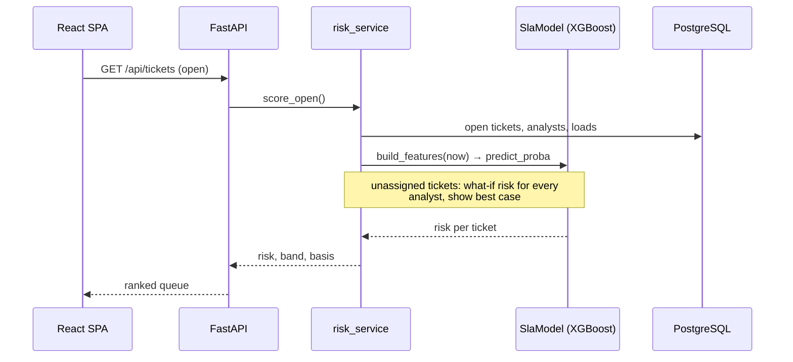
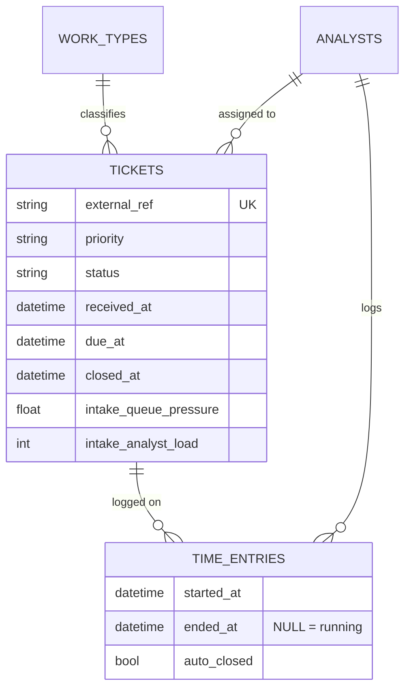

# Architecture

## Request flow

## Layers

| Layer | Responsibility | Files |
|---|---|---|
| Routes | HTTP, validation (Pydantic), response models | `api/routes.py`, `schemas.py` |
| Services | Business rules: ticket lifecycle, timers, KPIs, risk scoring, ingest | `services/*` |
| Repositories | Data access behind an abstract `BaseRepository` | `repositories/*` |
| ML | Features, model, balancer, forecast, registry | `ml/*` |
| Models | SQLAlchemy ORM and DB constraints | `models.py` |

## Data model

## Design decisions

**Server-authoritative timers.** The prototype kept timer state in the UI framework (Streamlit), which broke with dozens of concurrent users. Here the database stores `started_at`, and the browser renders `now − started_at` every second. Starting a new timer stops the previous one. A partial unique index `(analyst_id) WHERE ended_at IS NULL` guarantees one running timer per analyst even under concurrent requests; the losing request gets a 409. A reconciliation job force-closes timers left running longer than 10 hours (flagged `auto_closed`).

**Feature snapshots at intake.** `intake_queue_pressure` and `intake_analyst_load` are written when a ticket arrives or is assigned. Training reads them, so the model never sees information from the future.

**What-if scoring.** For a ticket, the feature row is replicated once per active analyst with that analyst's load, skill match and speed, then scored in one batch. The ranking adds a small load penalty to the predicted risk so the recommender balances work instead of piling onto the single best analyst.

**Batch assignment.** Each analyst is expanded into `max_open − current_load` slots. Each slot's cost is risk + load penalty, increasing as the analyst fills up. `scipy.optimize.linear_sum_assignment` finds the global minimum-cost plan. The lead previews it and applies it in one click.

**Forecast → FTE.** One Holt-Winters model per work type (additive weekly seasonality, damped trend). The forecasts are summed so a change in mix shows up as a change in workload. Workload minutes = Σ volume × median handle time (last 90 days). Weekend inflow rolls to Monday. Required FTE = workload ÷ (480 min × 80% utilisation), compared with headcount × (1 − 8% shrinkage).

**Security hygiene.** No secrets in code (env-based config), no stack traces to users (global exception handler logs server-side), path-traversal-safe SPA route, upload size and row limits, container runs as non-root.
